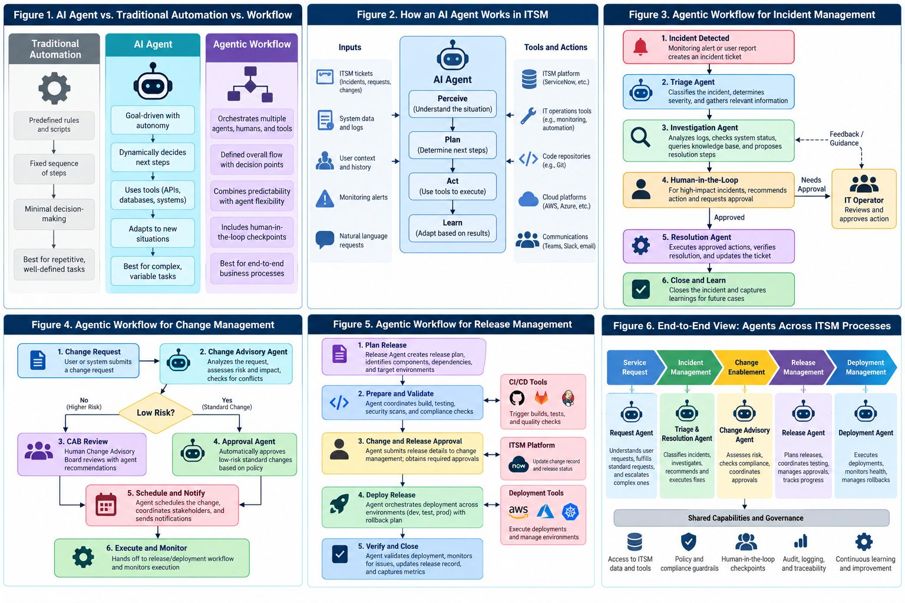

# Lecture: ITSM, AI agents, agentic workflows, and where analytics fits

A conceptual lecture, about 65 minutes, given at the start of Module 7 before the hands-on sessions on
change management. No terminal today. Everything named here is something you have already built or will
build in this course, so the second half of each section says where the idea lives in the repository.

## Learning objectives

By the end you will be able to:

1. Define an AI agent and an agentic workflow, and tell both apart from a script and from a fixed workflow.
2. Describe ITSM under ITIL 4: the service value chain, the four dimensions, and the three practices that
   matter for the rest of this course: change enablement, release management, deployment management.
3. Explain why change and release are the least mature places to put an agent, and what the industry does
   about that: deterministic gates, human-in-the-loop checkpoints, incremental scope.
4. Place the four kinds of analytics (descriptive, diagnostic, predictive, prescriptive) inside the agent's
   loop and inside the ITIL practices, with one example of each from this course.
5. Sketch an agentic workflow for an ITSM scenario and mark its checkpoints, guardrails, data sources, and
   the analytics that feed it.

## Outline

| Time | Section |
|---|---|
| 0 to 5 | I. Two things changing at once |
| 5 to 15 | II. Agents and agentic workflows |
| 15 to 27 | III. ITSM and ITIL 4 |
| 27 to 38 | IV. Change enablement, release management, deployment management |
| 38 to 50 | V. Where analytics fits |
| 50 to 58 | VI. Agents in ITSM today, and the governance problem |
| 58 to 65 | VII. Synthesis, discussion, and the exercise |

The one-page context diagram for the whole lecture is below; each section comes back to one of its six
figures.

## I. Two things changing at once (5 min)

Two shifts in enterprise IT are landing at the same time.

1. **Service management has loosened.** ITIL 4 (2019) replaced the gatekeeping processes of ITIL v3 with
   practices that are meant to enable value, not block it. "Change management" became "change
   enablement" on purpose.
2. **Automation has become goal-directed.** A script does what it is told, in order. An AI agent is given a
   goal and a set of tools and decides the steps itself.

Put the two together and the question this course is built around appears: **who approves an agent's
decision to change a production system, how is the decision recorded, and how is it undone?** Those are
not hypothetical. They are the design of `Registry.dispatch`, the approval queue, and the before-image in
Module 7. And the premise of this course is that the answer is not only governance; it is analytics. An
agent that cannot measure its own effect on the desk cannot be trusted with the desk.

## II. Agents and agentic workflows (10 min)

Figure 1 in the diagram.

**Traditional automation.** Predefined rules, a fixed sequence of steps, minimal decision-making. Your Rung
0 poller is exactly this: read new tickets, apply keyword rules in order, first match wins. Reliable,
auditable, and blind to anything the rules did not anticipate.

**An AI agent.** A program driven by a language model that can perceive its situation, choose among
actions, use tools, and adapt as results come back. Four properties: autonomy within limits, tool use, adaptation,
goal orientation. Figure 2 shows the loop: **perceive** (tickets, system data, user context, alerts),
**plan** (decide the next step), **act** (call a tool: the ITSM platform, monitoring, a code repository,
a message), **learn** (adjust from the result).

**An agentic workflow.** A business process in which agents, people and systems are arranged in a defined
overall flow with decision points. The flow is fixed; what happens inside a step may be dynamic. This is
the practical shape of nearly every real deployment: a deterministic skeleton that calls agents at
well-defined points and puts a human at the points that matter.

The distinction that matters for ITSM is **predictability versus adaptability**. A workflow gives you an
execution path you can audit before it runs. An agent gives you the ability to handle a ticket nobody wrote
a rule for. You want both, and you want to know at every step which one you are using.

**In this course.** The registry is the workflow skeleton: one door, four tiers, every call logged. The
tools behind it are deterministic. The model, when it arrives in the loop (Rung 4), only chooses *which*
door to knock on; it cannot change what is behind any of them. Figure 1's three columns are, in order,
your Rung 0, your Rung 4, and the whole repository.

Three phases every agentic workflow goes through: planning (interpret the goal, choose a strategy),
execution (act through tools), iterative adaptation (evaluate, revise, escalate). The word to keep is
**escalate**: an agent that cannot say "I am not sure, a person should look" is not safe to run.

## III. ITSM and ITIL 4 (12 min)

**ITSM** is the discipline of running IT as a set of services that meet business needs: the practices by
which services are designed, delivered, supported and improved. It is not the technology; it is the
management of the technology as a service with customers, targets and costs.

**ITIL 4** is the current edition of the most widely used ITSM framework. Its centre is the **service value
system**, and the centre of that is the **service value chain**, six activities that are not a sequence:

| Activity | What it means | Where you have seen it |
|---|---|---|
| Plan | Strategy and direction | COURSE_CONTEXT's capability ladder |
| Engage | Understand what stakeholders need | the SLA page (Module 3) |
| Design and transition | Create and change services | every ADR; the model pin (Module 4) |
| Obtain and build | Acquire or build components | training a classifier (Modules 3 and 4) |
| Deliver and support | Run the service, resolve incidents | the poller, the read tools, the write tools |
| Improve | Measure and improve | the eval harness; the KPIs (Module 8) |

ITIL 4's **four dimensions** say that any service has to be looked at from four sides at once:
organizations and people; information and technology; partners and suppliers; value streams and
processes. An agent touches all four. It is technology; it changes who does what; it is usually supplied
by a vendor; and it sits inside a value stream. A deployment that considers only the second dimension
fails on the other three.

Three ITIL 4 **practices** carry the rest of this lecture:

| Practice | Purpose |
|---|---|
| Change enablement | Maximize successful changes by assessing risk and authorizing changes to proceed |
| Release management | Make new and changed services available for use |
| Deployment management | Move new or changed components into live environments |

They are related and distinct, and confusing them is a common source of unclear ownership. The next
section takes them one at a time.

## IV. Change enablement, release management, deployment management (11 min)

Figures 4 and 5 in the diagram.

### Change enablement

The purpose is to **maximize the number of successful changes** by assessing risk, authorizing the change,
and managing the schedule. Three change types:

| Type | What it is | Who approves |
|---|---|---|
| Standard | Pre-approved, repeatable, low risk (monthly patching, a standard laptop) | Nobody, each time; the type was approved once |
| Normal | Needs assessment and approval; most of the pipeline | The CAB or a delegated authority |
| Emergency | Urgent, expedited; reviewed afterwards | An emergency CAB or named authority |

The **change advisory board** is the traditional approver of normal changes, and its failure modes are
well known: too many changes for the time available, so the risky one slips through; change records
without a credible back-out plan or test evidence; hours of manual cross-referencing against incident
history, asset criticality and dependencies; decisions that get worse as the meeting gets longer.

Modern guidance answers with four habits: anchor every change to a business service, not only a
configuration item; apply tiered risk rules by service criticality, with multipliers for concurrent
changes; graduate proven procedures from normal to standard on evidence; and use AI to map raw text to
services and to correlate dependencies. Note that the last one is a data task before it is an agent task.

**In this course.** The three change types are the three write tiers. `propose` is a change record the
agent drafts and a human makes. `execute_with_approval` is a normal change: a named person approves this
exact call and the program makes it once. `autonomous` is a standard change, and no tool has it, because
nothing has earned it yet. The before-image is the back-out plan the CAB keeps asking for. The six rows
in `data/eval/changes.csv` are the desk's own change history, and Module 8 reviews whether "successful"
was true for all of them.

### Release management

A **release** is one or more changes to a service that are built, tested and deployed together. Release
management plans, schedules and controls the release as a whole, technical and non-technical parts
included, and protects the services already running. In an Agile or DevOps setting releases are small and
frequent, often staged: a pilot to a few users before the rest.

**Deployment management** is the narrower act of moving components into a live environment. One release
may involve several deployments. Change enablement makes the go or no-go decision; release management
coordinates what follows; deployment is the moving of bits.

**In this course.** A tag is a release. `v0.1` bundled a trained model, its card, its ADR, a pin and an
eval report. The GitHub release page is the release record; `git pull` on your laptop is the deployment.
That is small, but it is the whole shape, and it is why the course insists on a tag per rung.

## V. Where analytics fits (12 min)

This section is the one the vendor material leaves out, and it is the one this course is built on.

### Four kinds of analytics, one loop

Analytics is usually taught as a ladder of four questions. Each one lives at a different point in the
agent's perceive-plan-act-learn loop (Figure 2), and each one is a specific thing you build in this course.

| Kind | The question | In the agent's loop | In this course |
|---|---|---|---|
| Descriptive | What happened? | Perceive: the facts the agent and its operators see | KPIs: MTTR, SLA attainment, backlog aging, Pareto (Module 8); the Module 2 notebook |
| Diagnostic | Why did it happen? | Learn: explaining an outcome after the fact | Change-impact analysis: did a change cause incidents (Module 8); clustering into problem candidates (Module 13) |
| Predictive | What will happen? | Plan: a label or a score before acting | Category classifier (Modules 3 and 4); SLA breach-risk score (Module 10); volume forecast (Module 11) |
| Prescriptive | What should be done? | Act: a recommendation with a tier | Routing a ticket to a group; proposing an assignment or a resolution (Module 7); retraining policy (Module 14) |

Two points about that table.

**First, the model is not the analytics.** The classifier is one predictive cell. Most of the value, and
most of the risk, sits in the descriptive and diagnostic rows, which are `groupby` and a comparison against
a baseline. A desk that cannot say what its MTTR was last month cannot tell whether an agent made it
better.

**Second, prescriptive analytics is where the tiers live.** A recommendation ("assign to Network Ops") is
analytics until it is acted on. The tier decides whether the agent may act on its own recommendation.
That is the whole connection between the analytics thread and the governance thread of this course:
analytics produces the recommendation, change management decides who may execute it.

### Analytics inside each ITIL practice

Figure 3 and Figure 4, read with the analytics table beside them.

- **Incident management (Figure 3).** Triage is prediction (category, priority, group). Investigation is
  retrieval, which is similarity analytics: which resolved incidents look like this one, which article
  answers it. Resolution is prescriptive. Close and learn is descriptive: the ticket joins the history that
  trains the next model.
- **Change enablement (Figure 4).** The change advisory agent's risk rating is predictive analytics built
  on descriptive inputs: incident history for this configuration item, change failure rate, concurrent
  changes. The "low risk?" diamond is a threshold on a score, and who sets the threshold is a governance
  decision. The post-implementation review is diagnostic: the Module 8 method, observed against expected
  in the window after the change, by category, is exactly what a review should run every time.
- **Release management (Figure 5).** Release readiness is a scorecard: tests, coverage, dependency checks,
  security scans. Verify and close is descriptive again: metrics after deployment against metrics before.
  For a model release, that is the bake-off table and the harness.

### The data foundation is an analytics problem

Every vendor says the same thing after a first deployment: **agents are only as good as the data behind
them**. An agent rating change risk needs accurate configuration items, dependencies, vulnerability data
and incident history. With a half-maintained CMDB it produces confident, wrong ratings, and it produces
them faster than the people it replaced.

The analytics reading of that sentence: before an agent, run the descriptive analytics. If the KPIs cannot
be computed cleanly from the data (missing timestamps, categories that mean different things in different
teams, assignment groups that no longer exist), the agent will inherit every one of those defects. You hit
this in Module 2: the PDI stamped every historical timestamp with the load time, so time-based analytics
had to read the CSV and join on a correlation id. That was a data-foundation finding, and it shaped the
whole course.

### Evaluating the agent is analytics too

The eval harness is a measurement program. Its four metrics are descriptive statistics of the agent's
behaviour on a fixed holdout set, and `harmful_action_count` is the one that turns governance into a
number. Module 14 adds drift detection, which is diagnostic analytics on the agent itself: has the input
distribution moved, has accuracy fallen, and does the retraining policy say to act. An agent program with
no measurement program is a demo.

### What a business analyst does in an agent project

The job is not "write the model". It is, in order: define the KPIs the agent is supposed to move and
measure them before anything is deployed; find and fix the data defects the KPIs expose; build or
evaluate the predictive pieces against a time-based holdout; design the recommendation and the threshold
that turns it into an action; and own the post-implementation review. Every one of those is a module of
this course.

## VI. Agents in ITSM today, and the governance problem (8 min)

### Maturity

Not every ITSM task is equally ready for an agent:

| Tier | Use case | Maturity |
|---|---|---|
| 1 | Incident triage, knowledge retrieval, ticket deflection | Most mature |
| 2 | Request fulfilment, automated incident creation | Emerging |
| 3 | Change approval, autonomous release decisions | Least mature, highest risk |

The principle underneath: **the more consequential and the less reversible the action, the more caution
it needs.** A wrong triage is reassigned in a minute; a wrong production change may not be undoable. The
capability ladder of this course climbs this table from the bottom row of risk to the top.

### What vendors ship (2026)

- **Change manager agents** (Lansweeper's Change Manager, BMC Helix's Change Risk Advisor, ServiceNow's
  intelligent change management) read a change request, cross-reference incident history, asset
  criticality, vulnerabilities and collision rules, and produce a risk rating with a recommendation:
  approve, approve with conditions, escalate. Some auto-approve low-risk normal changes against policy.
- **Release agents** (AWS DevOps Agent's release manager tools; multi-agent release teams arranged as a
  directed graph of release manager, CI/CD, tester, docs, dependency and security agents) run readiness
  reviews on every pull request and gate on human approval at defined points.
- **ReleaseOps.** The newest idea: an agent's prompts, policies and model configuration are a versioned
  artifact and are promoted through gated environments like any software. An agent is itself software
  that must be released. You already do this: the model pin, the card, the tag.

### Governance

Four questions traditional frameworks were not built to answer: who is accountable when an agent's
decision causes an outage; how the agent's reasoning is reconstructed afterwards; which changes an agent
may approve alone; when and how it hands off to a person.

Industry practice is converging on four patterns, and each one has a file in this repository:

| Pattern | What it is | Here |
|---|---|---|
| Deterministic gating layer | Hard rules the agent cannot argue with, with the agent's judgement inside them | Tiers in schema files; `dispatch` |
| Pre and post guardrails | Checks before the action and verification after it | Target-exists checks; before-image and after-image |
| Human-in-the-loop checkpoints | High-risk actions need a named approver even after the agent assessed them | The approval queue; `--as NAME` |
| Checkpointing and recovery | State is saved so an interrupted workflow resumes without acting twice | Idempotency keys; the Module 14 scenario `process_kill_mid_workflow` |

ITIL 4 turns out to be a usable scaffold for all of this. It already says what has to be managed when
many semi-autonomous actors change a shared system: change enablement, problem management, capacity,
quality. Organizations with a working ITSM foundation will govern agents better than those without one.

## VII. Synthesis, discussion, exercise (7 min)

### Six things to keep

1. Agentic workflows move automation from fixed sequences to goal-directed, adaptive steps inside a
   defined flow. The flow is where the control lives.
2. ITIL 4's three practices, change enablement, release management and deployment management, are the
   governance frame, and they map onto tiers, tags and pulls in this repository.
3. Agents are mature for triage and retrieval, emerging for requests, and least proven for change and
   release. Climb in that order.
4. Analytics is not a feature of the agent; it is the loop the agent runs in. Descriptive before
   deployment, predictive inside planning, prescriptive at the tier boundary, diagnostic afterwards.
5. The data foundation is an analytics problem, found by computing the KPIs first.
6. An agent is software to be released: prompts, policies, models, versioned and gated.

### Discussion questions

1. An agent auto-approves a standard change that causes a major outage. Who is accountable: the people who
   built the agent, the change manager who set its autonomy threshold, or the CAB that delegated the
   authority? Design an accountability rule in three sentences.
2. A company with a half-accurate CMDB wants a change manager agent. What do you measure before deploying
   anything, and what guardrails hold for the first six months?
3. The Module 8 change-impact method as a standing post-implementation review: which of the four analytics
   kinds is it, what threshold would you set on the ratio, and what would you do with a result that
   depends on the window length?
4. ReleaseOps treats prompts and model configurations as versioned artifacts. What belongs in the release
   notes of an agent behaviour change, and who should have to approve it?

### Exercise (10 min if time allows)

You are the ITSM lead at a 2,000-person company: 400 to 500 normal changes a month, a weekly CAB that runs
three hours, a 12 percent change failure rate. Leadership has approved a pilot of a change manager agent.
Design its scope and guardrails:

- Which change types may it approve alone, and which always go to a person?
- Which data sources must it have, and which KPI would you compute first to find out whether those
  sources are good enough?
- What are the success metrics for a 90-day pilot, measured how, against what baseline?
- What happens when the agent is unsure?

Write it as a one-page memo. The questions are the same ones the governance document in Module 8 asks
about your own program.

## Readings

- UK Government, "AI Insights: Agentic Workflow" (2026).
- Lansweeper, "The Change Manager Agent: How Agentic AI Can Transform Change Enablement" (2026).
- Freshworks, "ITSM Change Management Best Practices: A Practical Guide" (2026).
- AWS, "Release Manager tools for custom agents", DevOps Agent documentation (2026).
- Atomicwork, "ITIL 4: Core concepts, guiding principles, and practices" (2025).
- This repository: `COURSE_CONTEXT.md` (the three threads and the ladder), `docs/governance/governance.md`,
  lectures 07a to 08b.

## Vocabulary

| Term | Meaning |
|---|---|
| AI agent | A program driven by a language model that perceives, plans, acts through tools, and adapts |
| Agentic workflow | A defined process in which agents, people and systems act at set points, with dynamic steps inside |
| ITSM | IT service management: running IT as services that meet business needs |
| ITIL 4 | The current edition of the most widely used ITSM framework (2019) |
| Service value chain | ITIL 4's six activities: plan, engage, design and transition, obtain and build, deliver and support, improve |
| Change enablement | The practice that assesses risk and authorizes changes |
| Release management | The practice that makes new and changed services available |
| Deployment management | The practice that moves components into live environments |
| CAB | Change advisory board, the approver of normal changes |
| Standard / normal / emergency change | Pre-approved; approved each time; made first and reviewed after |
| Guardrail | A constraint the agent cannot talk its way past |
| Human-in-the-loop | A checkpoint where a named person decides before the agent acts |
| Descriptive / diagnostic / predictive / prescriptive | What happened; why; what will happen; what to do |
| Baseline | What would have happened anyway; the thing every "did it work" question is measured against |
| Data foundation | The quality of the records an agent reads; found by computing the KPIs |
| ReleaseOps | Releasing an agent's prompts, policies and models as versioned, gated artifacts |
